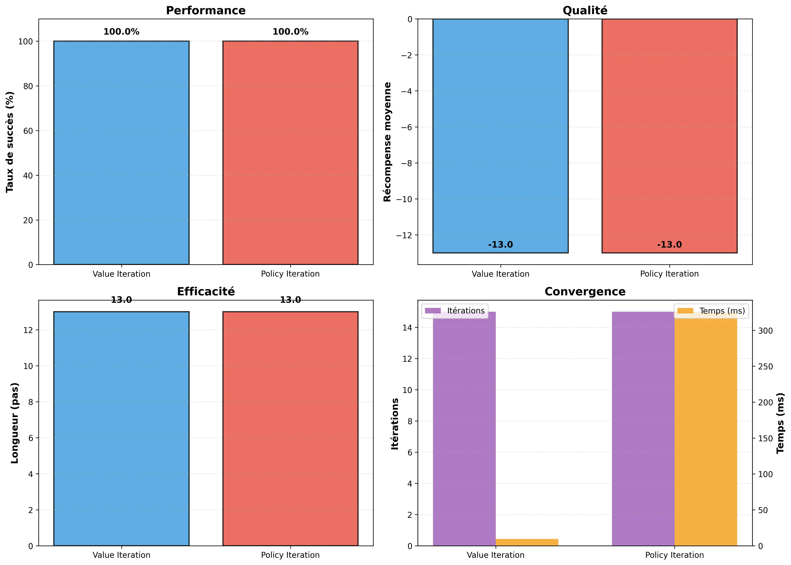
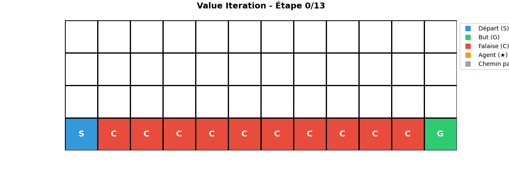

# Value Iteration vs Policy Iteration — CliffWalking

**A Comparative Study of Dynamic Programming Algorithms for Optimal Decision-Making in Reinforcement Learning.**

An implementation and experimental comparison of **Value Iteration** and **Policy Iteration** using the CliffWalking-v1 environment from Gymnasium.

Academic lab project — **Deep Learning**, Big Data & Artificial Intelligence track, National School of Applied Sciences of Tetouan (ENSA), Abdelmalek Essaadi University.

**Author:** Abdessamad Ait Brahim  
**Module:** Deep Learning  
**Supervisor:** Dr. Anas Belcaid  
**Academic Year:** 2024–2025

---

<div align="center">

[](#project-overview)
[](#cliffwalking-environment)
[](#1-value-iteration)
[](#2-policy-iteration)
[](#experimental-results)
[](#optimal-policy-and-trajectories)
[](#notebook-content)
[](#documentation)
[](#author)

</div>

---

## 1. Project Overview

Reinforcement Learning focuses on how an agent learns to make optimal decisions by interacting with an environment and maximizing cumulative rewards.

This project explores two fundamental Dynamic Programming algorithms:

- **Value Iteration:** Computes the optimal state-value function through repeated Bellman optimality updates.
- **Policy Iteration:** Alternates between policy evaluation and policy improvement until the optimal policy is reached.

Both algorithms are implemented and evaluated in the **CliffWalking-v1** environment to compare their convergence, computational efficiency and solution quality.

### Main objectives

- Understand Dynamic Programming in Reinforcement Learning.
- Implement Value Iteration from scratch.
- Implement Policy Evaluation and Policy Iteration.
- Extract optimal policies using the environment's transition model.
- Compare convergence and execution time.
- Evaluate policies through simulation.
- Visualize optimal agent trajectories.

## 2. CliffWalking Environment

The experiments use the [Gymnasium](https://gymnasium.farama.org/) `CliffWalking-v1` environment.

### Environment description

The environment consists of a 4 × 12 grid where an agent must navigate from the starting position to the goal while avoiding a dangerous cliff.

### Environment specifications

| Property | Value |
|---|---|
| Grid Size | 4 × 12 |
| Total States | 48 |
| Available Actions | 4 |
| Starting State | 36 (bottom-left) |
| Goal State | 47 (bottom-right) |
| Cliff States | 37–46 |
| Dynamics | Deterministic |

### Action space

| Action | Direction |
|---|---|
| 0 | Up |
| 1 | Right |
| 2 | Down |
| 3 | Left |

### Reward system

| Event | Reward |
|---|---:|
| Normal movement | -1 |
| Falling off the cliff | -100 |
| Reaching the goal | -1 |

When the agent falls off the cliff, it is sent back to the starting position.

## 3. Dynamic Programming Algorithms

Both algorithms use the known transition model provided by:

```python
env.unwrapped.P
```

### Shared parameters

| Parameter | Value |
|---|---:|
| Discount Factor (γ) | 0.9 |
| Convergence Threshold (θ) | 1e-6 |
| Maximum Value Iteration Updates | 5000 |
| Maximum Policy Iteration Cycles | 100 |

### 1. Value Iteration

Value Iteration repeatedly applies the Bellman optimality equation to estimate the optimal value of every state.

**Bellman optimality update:**

\[
V(s) \leftarrow \max_a \sum_{s',r}P(s',r|s,a)
[r+\gamma V(s')]
\]

The implementation follows these steps:

1. Initialize the state-value function.
2. Compute the Bellman optimality update for each state.
3. Measure the maximum change between successive value functions.
4. Stop when the convergence threshold is reached.
5. Extract the optimal greedy policy.

Updates are performed synchronously, with a maximum of 5000 iterations.

### 2. Policy Iteration

Policy Iteration searches for an optimal policy by alternating between two stages.

**Policy Evaluation**

Calculate the state-value function associated with the current policy.

**Policy Improvement**

Update the policy by selecting the action that maximizes the expected return.

The implementation follows these steps:

1. Initialize the policy using an always-go-right strategy.
2. Evaluate the current policy.
3. Improve the policy using greedy action selection.
4. Compare the updated policy with the previous one.
5. Stop when the policy no longer changes.

The algorithm allows a maximum of 100 policy improvement cycles.

## 4. Experimental Results

Both algorithms were evaluated through simulation using 100 episodes.

### Performance comparison



| Metric | Value Iteration | Policy Iteration |
|---|---:|---:|
| Success Rate | 100% | 100% |
| Mean Reward | -13.00 | -13.00 |
| Mean Episode Length | 13 steps | 13 steps |
| Iterations | ~15 | ~15 |
| Execution Time | ~0.0094 s | ~0.3259 s |

### Key observations

- Both algorithms converge to the same optimal policy.
- Both achieve a 100% success rate.
- Both find the shortest possible 13-step trajectory.
- Value Iteration is approximately **35 times faster** in the recorded experiment.
- Policy Iteration requires additional computation because it evaluates intermediate policies before improving them.

*Execution times are experimental measurements and may vary depending on hardware and implementation.*

## 5. Optimal Policy and Trajectories

Both algorithms discover the same optimal strategy for reaching the goal while avoiding the cliff.

### Optimal policy

```text
[→] [→] [→] [→] [→] [→] [→] [→] [→] [→] [→] [↓]
[→] [→] [→] [→] [→] [→] [→] [→] [→] [→] [→] [↓]
[→] [→] [→] [→] [→] [→] [→] [→] [→] [→] [→] [↓]
[S] [C] [C] [C] [C] [C] [C] [C] [C] [C] [C] [G]
```

**Legend:**
- `S`: Starting position.
- `G`: Goal.
- `C`: Cliff.
- Arrows: Optimal movement directions.

### Optimal strategy — 13 steps

The optimal trajectory consists of:

1. Move one cell upward from the starting position.
2. Move 11 cells to the right along the row above the cliff.
3. Move one cell downward into the goal.

The resulting total reward is:

\[
R = 13 \times (-1) = -13
\]

This represents the shortest possible path without falling off the cliff.

### Trajectory animations

The following animations illustrate the optimal behavior discovered by each algorithm.

| Value Iteration | Policy Iteration |
|---|---|
|  |  |

## 6. Notebook Content

The complete implementation and experiments are available in:

`notebooks/TP_ai_gym_CliffWalking.ipynb`

The notebook is organized into the following sections:

1. Library imports and environment initialization.
2. Value Iteration implementation.
3. Policy Evaluation implementation.
4. Policy Iteration implementation.
5. Execution and performance measurement.
6. Policy evaluation through 100 simulation episodes.
7. Text-based policy visualization.
8. Algorithm comparison and plotting.
9. GIF generation for optimal trajectories.

## 7. Project Structure

```text
CliffWalking-Dynamic-Programming/
│
├── README.md
├── requirements.txt
├── .gitignore
│
├── notebooks/
│   └── TP_ai_gym_CliffWalking.ipynb
│
├── results/
│   ├── comparison_cliffwalking.png
│   ├── value_iteration.gif
│   └── policy_iteration.gif
│
└── docs/
    └── TP_CliffWalking_rapport.pdf
```

## 8. Installation & Execution

### Prerequisites

- Python 3.x
- Jupyter Notebook
- Gymnasium
- NumPy
- Matplotlib

### Step 1 — Clone the repository

```bash
git clone YOUR_REPOSITORY_URL
cd YOUR_REPOSITORY_NAME
```

### Step 2 — Create a virtual environment

```bash
python -m venv .venv
```

Activate it:

**Windows (Git Bash):**

```bash
source .venv/Scripts/activate
```

**Linux / macOS:**

```bash
source .venv/bin/activate
```

### Step 3 — Install dependencies

```bash
pip install -r requirements.txt
```

### Step 4 — Launch the notebook

```bash
jupyter notebook notebooks/TP_ai_gym_CliffWalking.ipynb
```

Run all notebook cells in order to reproduce the implementations, experiments and visualizations.

## 9. Conclusion

This project demonstrates the practical application of Dynamic Programming algorithms in Reinforcement Learning.

Both Value Iteration and Policy Iteration successfully identify the same optimal policy in the CliffWalking environment, achieving a 100% success rate and a minimum trajectory of 13 steps.

### Final comparison

**Value Iteration** proved to be the more computationally efficient approach in this experiment, while both algorithms achieved identical solution quality.

This study highlights the importance of understanding algorithmic convergence, policy optimization and computational complexity in intelligent decision-making systems.

## 10. Documentation

The complete academic lab report is available in French:

- [CliffWalking Lab Report (PDF)](docs/TP_CliffWalking_rapport.pdf)

## 11. Author

**Abdessamad Ait Brahim**

Big Data & Artificial Intelligence Student  
National School of Applied Sciences of Tetouan (ENSA)  
Abdelmalek Essaadi University

**Module:** Deep Learning  
**Supervisor:** Dr. Anas Belcaid  
**Academic Year:** 2024–2025

---

<div align="center">

**VALUE ITERATION vs POLICY ITERATION**

*Exploring Optimal Decision-Making Through Dynamic Programming.*

Reinforcement Learning · Gymnasium · Python · Dynamic Programming

Developed at ENSA Tetouan — 2024–2025

</div>